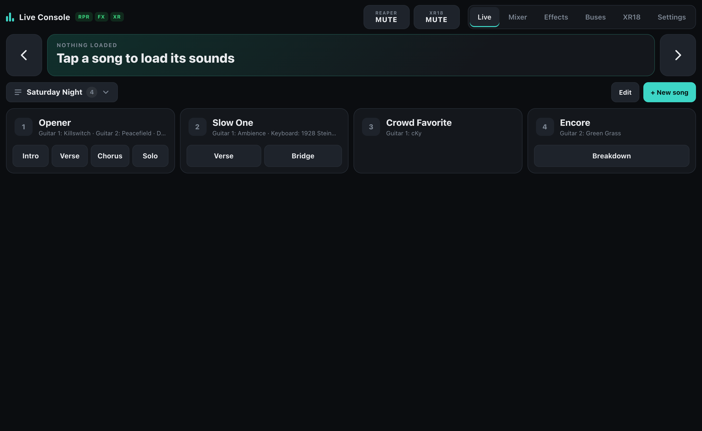
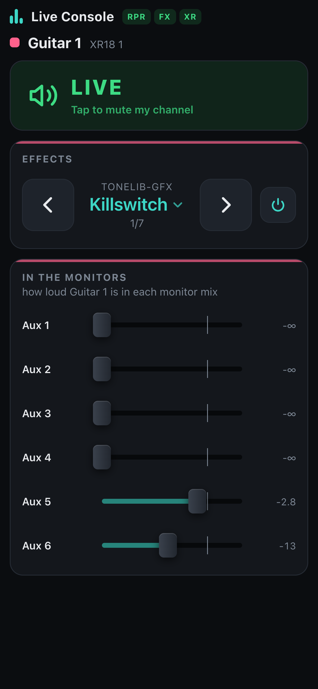
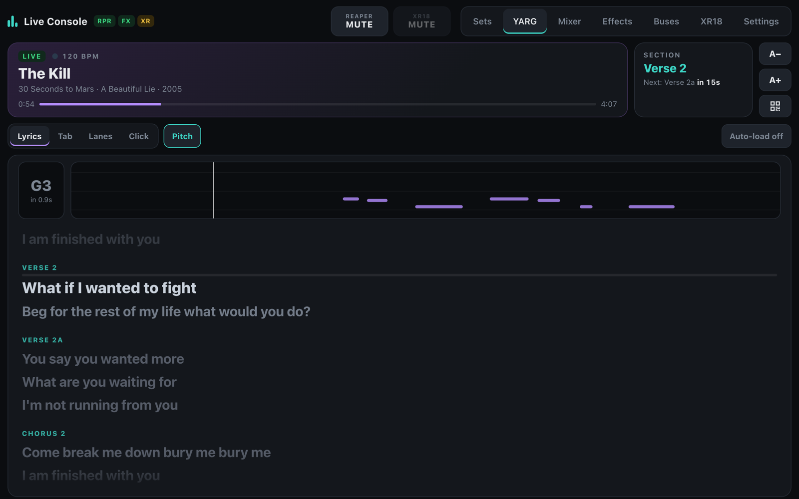
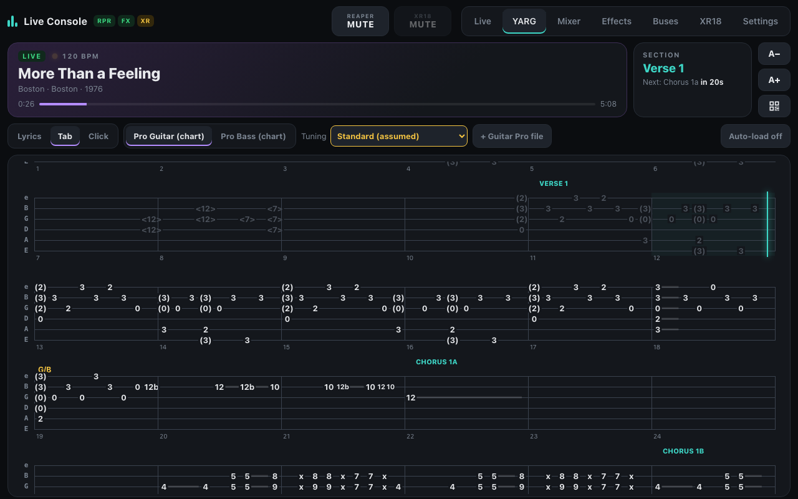
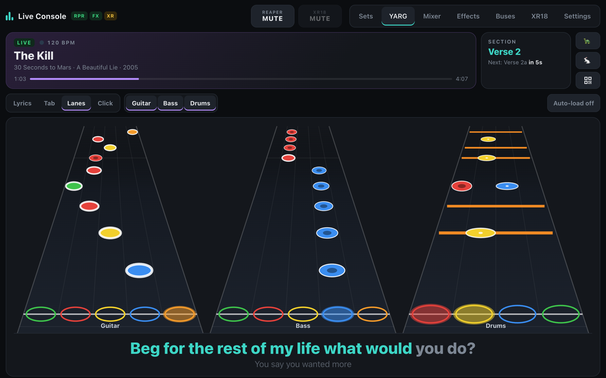
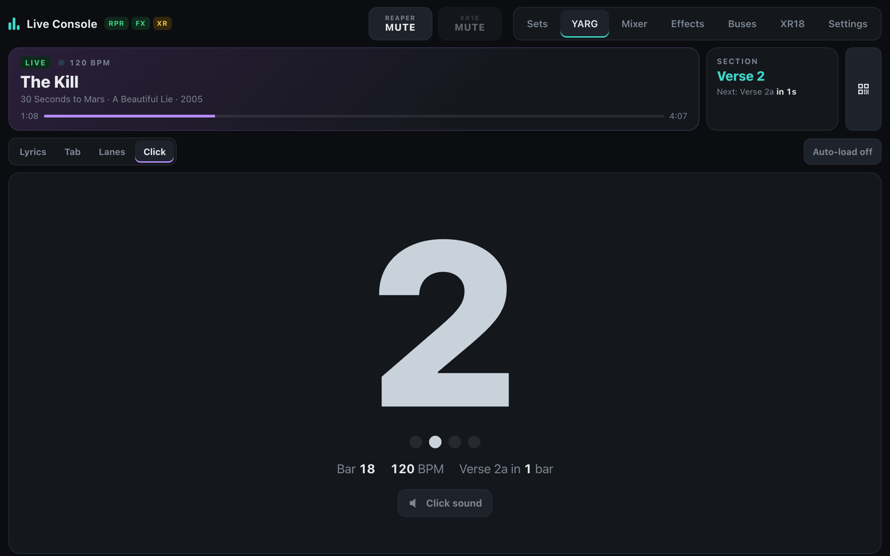
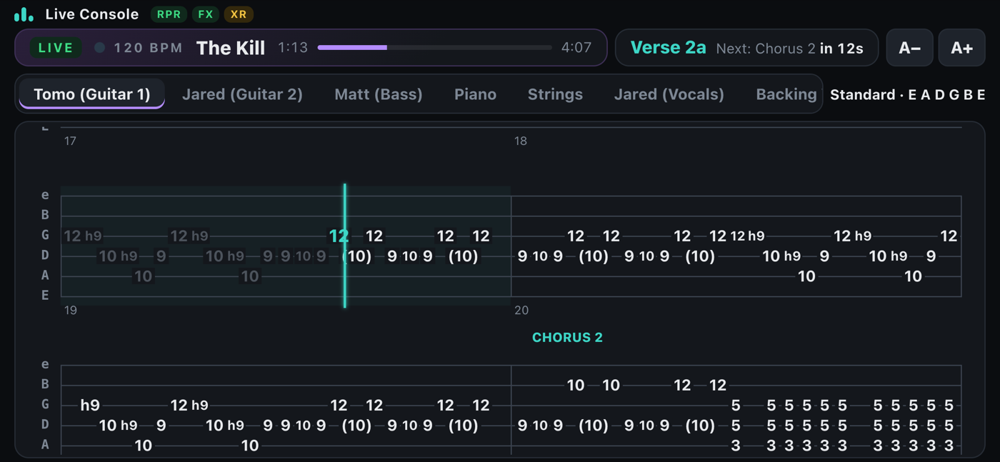

# Live Console

**A phone- and tablet-friendly web controller for live shows with REAPER and a Behringer X Air mixer (XR18 / X18 / XR16 / XR12 / MR18).**

REAPER hosts your amp sims, drum samplers and vocal effects; the X Air mixer is the audio interface and the stage mixer.
Live Console puts both on one screen: faders and meters for what you actually hear, effect presets you can switch by tapping a name,
whole-song sound recalls for every channel at once, monitor mixes, and a QR code that gives each musician their own controls on their phone.



## Features

- **Sets tab**: build songs that recall FX presets (and on/bypass) on every track at once. Songs can have **sections** (Intro, Verse, Solo…) that change only what's different.
  Organise songs into **setlists**: switch between them, drag to reorder, and export/import them as files. A status line confirms the sounds are loaded or shows what was changed by hand.
- **Mixer**: one strip per REAPER track, with the XR18 channel fader and meter for that track (what the audience hears), REAPER mute/solo/arm, the current preset with ‹ › and a tap-to-pick list, and a **LINE / USB** source switch per channel. Main LR on the right.
- **Effects**: every effect on every track, with big preset buttons and bypass.
- **Track pages**: everything for one channel. That's presets, REAPER fader, XR18 channel (source, mute, level), sends to Aux 1–6 and FX 1–4, and **gate / EQ (with a draggable response curve) / compressor** editors.
- **Buses**: monitor mixes "sends on faders" style. Pick a bus to see every source's send into it, with meters and the bus master.
- **Artist pages + QR codes**: one tap on a track page shows a QR code. A musician scans it and gets *their* channel on their phone: a big mute, their effect presets, and how loud they are in each monitor. There's nothing that can upset front-of-house.
- **YARG tab** (appears while [YARG](https://yarg.in) is running on the REAPER computer): **live lyrics** in time for the singers (harmony parts, pitch guide), **tablature** in time for guitar and bass (from the chart's Pro parts or a Guitar Pro file), **note lanes** for every part (an audience screen), the **keyboard part falling onto piano keys** (from the chart's Pro Keys or a Guitar Pro file's piano, organ or synth), a **click** for the drummer, **auto-loading the Live song** that matches YARG's (sections included), the menu music, and **scores**. QR codes put any of these alone on a performer's phone. See [YARG](#yarg).
- **XR18 tab**: all 16 channels plus aux, with mute, source, fader and meter.
- Smooth 60 fps meters straight from the mixer. Changes made in X-Air Edit or on another device show up live. Works offline (no CDN), dark UI, sized for touch.

| Mixer | Track page | EQ |
|---|---|---|
|  |  |  |

| Buses | Artist view (phone) |
|---|---|
|  |  |

## Requirements

- **REAPER** 6 or 7 (tested on 7.86, macOS)
- A **Behringer X Air** mixer on the same network as the REAPER computer (tested on XR18, firmware 1.25; the X Air family shares one OSC protocol, so X18/XR16/XR12/MR18 should work, but they're untested. Channels a model doesn't have just show as empty)
- **Node.js 18+** on the REAPER computer ([nodejs.org](https://nodejs.org)). It runs the small bridge that talks to the mixer (22.13+ for YARG scores).
- Optional: **YARG** on the same computer, for the YARG tab
- Phones, tablets and laptops on the same network, with any modern browser

## Install

In a terminal on the computer that runs REAPER:

```sh
git clone https://github.com/lilBadWolf/reaper-xair-live-console.git
cd reaper-xair-live-console
npm install
npm run setup
```

No git? [Download the ZIP](https://github.com/lilBadWolf/reaper-xair-live-console/archive/refs/heads/main.zip), unzip it anywhere you like, and run `npm install` and `npm run setup` inside the folder.
Keep the folder: REAPER runs the helper script and the mixer bridge from it, so moving or deleting it disconnects Live Console (run `npm run setup` again after moving it).

`npm run setup` finds your REAPER resource folder and does three things:

1. builds the page and copies it to `reaper_www_root/live-console.html`
2. adds a few lines to `Scripts/__startup.lua` (between clearly marked comments, with a `.bak` of the original) so the helper script runs whenever REAPER starts
3. tells you whether REAPER's web interface is already set up for it

Then, once, in REAPER:

1. **Preferences → Control/OSC/web → Add → Web browser interface**
   - *Default interface*: `live-console.html`
   - *Port*: e.g. `8080`
2. **Restart REAPER**, or run `reaper/live_console.lua` once via *Actions → Show action list → New action → Load ReaScript*.
3. Open `http://<your-computer's-ip>:8080/` on any device on the network. Setup prints the exact address.

The mixer is found automatically. To set its address by hand, go to *Settings → XR18 connection*.

Setup options: `--reaper "<resource folder>"` (portable installs, or if auto-detect fails; in REAPER: *Options → Show REAPER resource path*),
`--page <name>.html` (a different page name), `--deploy-only` (skip the startup script).

### Updating

```sh
cd reaper-xair-live-console
git pull           # (ZIP install: download the new ZIP and unzip it over the old folder)
npm install
npm run deploy     # rebuilds and re-copies the page; restarts the bridge if its code changed
```

Reload the page on your devices. The bridge restarts by itself when its code changed (or tap *Settings → Restart bridge* on the REAPER computer). If `reaper/live_console.lua` changed, restart REAPER or run the script again; a new copy replaces the running one.

## Using it

- **Channel mapping**: each REAPER track is linked to the XR18 channel it comes from, automatically. It uses the track's record input (XR18 USB 1–16 = channel 1–16, 17/18 = aux), then a matching channel name, then a linked stereo pair with the same name stem ("Keyboard" → "Key L"/"Key R"). Override per track in *Settings* or on the track page.
- **Presets**: the full list comes from REAPER's user preset files (`presets/*.ini`), i.e. presets you saved from REAPER's FX preset menu. A plugin's own built-in presets still work with ‹ ›, but without a list.
- **Songs**: dial in the sounds, then tap **+ New song**. It starts from the current presets. Songs refer to tracks and presets **by name**, so renaming one breaks the link (the status line will say so).
- **Faders**: drag (relative, so they never jump), shift-drag for fine control, double-tap for 0 dB. **Knobs**: drag up/down.
- **Artist mode**: on a device in artist mode, hold the logo for 1 s to get back to the full app.

### YARG

If the band also plays [YARG](https://yarg.in) (Rock Band style, on the REAPER computer), a **YARG** tab appears while it's running.

Just want the YARG dashboard, without REAPER or a mixer? [**yargDash**](https://github.com/lilBadWolf/yargDash) is the same YARG features as a standalone app that runs next to YARG.

**With yargDash running too**: both can run on the same computer. While yargDash is running, the bridge finds it (port 8900) and gets YARG through it instead of following YARG itself. The YARG tab then shows *via yargDash*, and everything matches yargDash: the same song, lanes and tabs, with tabs added and kept in yargDash (Live Console's own `tabs/` folder is used again when it's on its own). Only one program watches YARG and Downloads, and yargDash's *Send YARG's stream to this Mac only* works with both running. Auto-loading Live songs keeps working. When yargDash quits, the bridge follows YARG itself again within seconds. yargDash on another port? Set `"yargDashUrl": "http://127.0.0.1:<port>"` in `bridge-config.json`.

**Setup**
- In YARG: *Settings → All Settings → Experimental → **Enable UDP Data Stream*** (once). Without it you still get the song and its lyrics, but nothing follows the song.
- **On a Mac**, start YARG as usual. If your Mac blocks YARG's stream (YARG logs "Error sending UDP packet", and nothing follows the song), start YARG with `npm run yarg` (or double-click `yarg/Start YARG.command`) instead of the YARC Launcher. YARG broadcasts without the socket permission some Macs require (Windows doesn't check); the launcher loads a tiny library into YARG that adds it (`yarg/broadcast-fix.c`; YARG's files aren't changed). It needs Apple's command line tools (`xcode-select --install`) the first time.
- YARG installed somewhere unusual, or started with a custom data path? Enter the folder that contains `currentSong.json` in *Settings → YARG*.

**How it follows the song**: the bridge reads the song from YARG's `currentSong.json` and everything else straight from the song file (`.sng`, or a folder with `notes.mid` / `notes.chart`). YARG doesn't broadcast its playback position, so the bridge works it out from the data stream: the clock starts at the chart's first tempo marker, stops while YARG is paused, and lines up with every bar line YARG reports (picking up song speed too). Lyrics a bit early or late on one device (e.g. a slow phone)? *Settings → YARG → Lyrics timing*.

**Lyrics**: every line of the song with the current one near the top, syllables lighting up as they're sung, section headings, and a countdown before each entry. Pick **Lead / Harmony 1–3** per device; **Pitch** shows the notes coming up and names the one to sing. The Sets tab has a **Lyrics** button too.

**Tab**: guitar and bass tablature in time, laid out in bars like a printed tab, with a cursor and the current row near the top.
- Songs whose chart has **Pro Guitar/Bass** (Rock Band 3 songs) have it automatically.
- For any other song, on the REAPER computer (these buttons only show there) tap **Find tab** while it's playing: Ultimate Guitar's search for the song's Guitar Pro tabs opens in the browser. Pick one and download it: a Guitar Pro file that lands in *Downloads* and matches the song (by the title in the file, or the file name) is added by itself. The first time, macOS asks whether REAPER may use the Downloads folder: allow it. Or tap **+ Guitar Pro file** and pick a `.gp`, `.gpx`, `.gp5`, `.gp4` or `.gp3` file. Tabs are kept in `LiveConsole/tabs/`; files named `Artist - Title.gp5` dropped in that folder are found too.
- A Guitar Pro tab lines up with the song by itself: it works out how the tab's bars relate to the chart's (a 3/4 tab against a 4/4 chart is fine), plays out its repeats, then places it **section by section** by matching its rhythm to the chart's guitar/bass notes and its section names to the chart's. A repeat the tab doesn't write out, an extra chorus or a skipped section only moves the parts after it. The Tab view shows how well it matches and what it adjusted; **Bar offset** nudges everything if needed.
- **Tuning**: Guitar Pro files carry theirs, as do charts that record it (`real_guitar_tuning`). Many converted songs don't: the Tab view then marks the tuning *assumed* (standard) and lets you pick the right one (Drop D, E♭, Drop C…) per song and track. It only relabels the strings (the frets are the chart's) and is remembered for every device.

**Keys**: the keyboard part falling onto piano keys in time with the song. Each key lights up while its note sounds (right hand teal, left hand purple), with note names and the chord name when there is one; 🐢 / 🐇 set the speed. Songs whose chart has **Pro Keys** have it automatically (Rock Band's 17-key window is marked as it moves). A Guitar Pro file's keyboard parts (piano, organ, synth, clavinet…) show here instead of in the Tab view, lined up with the song like its tabs. Anything tabbed on 4 or 5 strings is a bass tab, even a synth bass, which shows in both.

**Click**: for the drummer: the beat in the bar (bar 1 highlighted), bar number and bars until the next section, timed from the chart. *Click sound* adds an audible click on that device.

**Lanes**: every part of the song as a note highway, side by side (guitar, rhythm, bass, drums, keys at Expert, whichever the chart has), whether or not anyone is playing it in YARG, with the line being sung underneath. Made for a screen facing the audience, or a preview. Shows hammer-ons and taps, open notes, sustains, star power, solos, and cymbals vs toms on pro drums. Pick which parts each device shows; 🐢 / 🐇 set the note speed.

**Auto-load** (YARG tab or *Settings → YARG*): when YARG starts a song, the song with the same name on the Sets tab loads ("The", "(Live)" etc. are ignored), and its sections follow YARG's: "Verse 2" loads the song's *Verse* section, "Pre-Chorus" its *Pre*, "Gtr solo" its *Solo*; a YARG section with no match goes back to the song's base sound. Only one device does the loading. *Up next* is the next song in the current setlist.

**Scores**: after a song, the band score, stars and each player's result (from YARG's own scores), and during a song your best for it. YARG doesn't share the live score while playing. Needs Node 22.13 or later.

**Menu music** (macOS/Linux): the song YARG plays in its menus shows too, with its lyrics. They follow the song when the bridge is sure it started from the top: when it follows the previous menu song, or is the first after YARG starts, or when you tap *Follow it*. (The music library's previews look the same from outside but start mid-song.) YARG doesn't report pausing or skipping the menu music, so tap *Stop following* if you do.

**Performer pages** (QR button on the YARG tab): `#yarg/stage` lyrics, `#yarg/stage/harm2` a harmony part, `#yarg/tab/<track>` a tab, `#yarg/click` the click, `#yarg/lanes` the lanes (audience screen), `#yarg/keys/<track>` the keys. Hold the logo for 1 s to get back to the full app.

| Lyrics with pitch guide | Tab, lined up with the song |
|---|---|
|  |  |
| **Lanes** (audience screen) | **Click** for the drummer |
|  |  |



## How it works

```
 phone / tablet / laptop                       REAPER computer
┌────────────────────────┐  HTTP (REAPER's   ┌────────────────────────────────────┐
│ live-console.html      │  web interface)   │ REAPER                             │
│ (Vue, one file)        │──────────────────▶│  └ reaper/live_console.lua         │
│                        │                   │      publishes FX + presets,       │
│                        │                   │      runs preset/bypass commands   │
│                        │  HTTP + SSE :8899 │                                    │
│                        │──────────────────▶│ bridge/xr18-bridge.mjs (Node)  ────┼── OSC/UDP :10024 ──▶ X Air mixer
└────────────────────────┘                   │  mixer relay, meters, songs store  │
                                             │  bridge/yarg.mjs ◀── currentSong.json, song files,
                                             │                  ◀── YARG data stream (UDP :36107)
                                             └────────────────────────────────────┘
```

- **REAPER side**: the page polls REAPER's built-in web API for tracks and mute/solo state. The Lua script publishes each FX's preset state through REAPER ExtState and applies commands the page writes back. No REAPER extensions required.
- **Mixer side**: browsers can't send UDP, so a zero-dependency Node bridge relays OSC. It subscribes to mixer updates (`/xremote`) and meters (`/meters/1`), streams them to every browser over Server-Sent Events, and stores the Sets tab's songs and setlists.
- **Your data** (songs, setlists, mixer address, bridge log) lives in `<REAPER resource folder>/LiveConsole/`, outside this repo, so updates never touch it. Back up `live-songs.json` with your show files.

## Troubleshooting

- **Status dots** in the header: **RPR** = REAPER web API, **FX** = the Lua script, **XR** = the mixer (yellow means the bridge is up but no mixer was found). *Settings* has details.
- **FX dot red**: the script isn't running. Restart REAPER, or load `reaper/live_console.lua` from the Action list.
- **XR dot red**: check `LiveConsole/bridge.log` in the REAPER resource folder. If Node isn't found (REAPER doesn't see your shell's PATH), set `NODE_PATH` at the top of `reaper/live_console.lua`. To run the bridge by hand: `npm run bridge`.
- **Mixer not found**: discovery uses a UDP broadcast. On some networks you need to enter the mixer's IP in *Settings → XR18 connection*.
- **Phones can't open the QR link**: they must be on the same network as the REAPER computer. Set the address in *Settings → QR codes* if the auto-detected one is wrong (e.g. a VPN interface).
- **OSC addresses**: *Settings → OSC learn* lists any change made in X-Air Edit, which is handy for exploring the protocol.

## Security

Built for a trusted local network (the band's own Wi-Fi). REAPER's web interface can be password-protected in its preferences, but the bridge on port 8899 has **no authentication**: anyone on the network can control the mixer through it. Don't expose either to the internet. Artist mode is for convenience, not a lock.

## Development

```sh
npm run dev       # hot reload at http://localhost:5173/live-console.html (proxies REAPER's API from :8080; REAPER_URL=... to change)
npm run build     # dist/live-console.html
npm run bridge    # run the bridge by hand (data in ./data)
```

```
src/                 Vue 3 app (views/, components/, lib/)
  lib/reaper.js      REAPER web API client + FX command channel
  lib/xr18.js        bridge client (SSE in, POST out)
  lib/meters.js      60 fps meter engine (outside Vue reactivity)
  lib/live.js        songs, sections, setlists
  lib/xrparams.js    X Air parameter scales (gate/EQ/comp), EQ response math
  lib/yarg.js        YARG song, lyrics, tabs and song clock (from the bridge)
  lib/yargAuto.js    auto-load the Live song/section matching YARG's
bridge/xr18-bridge.mjs   Node bridge (no dependencies except alphaTab, for Guitar Pro files)
bridge/tabs.mjs          YARG tabs: Pro Guitar/Bass from charts, Guitar Pro files (read with alphaTab) laid onto the chart's bars
bridge/lanes.mjs         YARG lanes: every five-fret/drum part of the chart (HOPOs, taps, opens, star power, solos, cymbals)
bridge/yarg.mjs          YARG: current song, lyric/harmony/beat parsing (.mid/.chart/.sng), song clock, menu song, scores
yarg/                    macOS launcher for YARG (data stream fix)
reaper/live_console.lua  REAPER helper script
scripts/setup.mjs        installer
```

Notes on the protocols:

- REAPER's web server truncates request URLs at about 1 KB, so the page only sends short commands. Bulk data (FX state) is written by the Lua script.
- X Air OSC values are normalised floats; the scales in `lib/xrparams.js` were checked against the mixer's own `/node` text output.
- `/meters/1` delivers 40 levels about every 100 ms (fixed by the mixer): ch 1–16, aux L/R, FX returns 1–4 L/R, buses 1–6, FX sends 1–4, main L/R, monitor L/R.

## Feedback

Bug reports and ideas are welcome in [Issues](https://github.com/lilBadWolf/reaper-xair-live-console/issues). It especially helps to hear how it does on X Air models other than the XR18, and on Windows or Linux.
Include your mixer model and firmware, REAPER version, OS, and `LiveConsole/bridge.log` if the mixer side is involved.

## License

[MIT](LICENSE)

*Not affiliated with Cockos or Behringer/Music Tribe. REAPER, X Air and XR18 are trademarks of their respective owners.*
