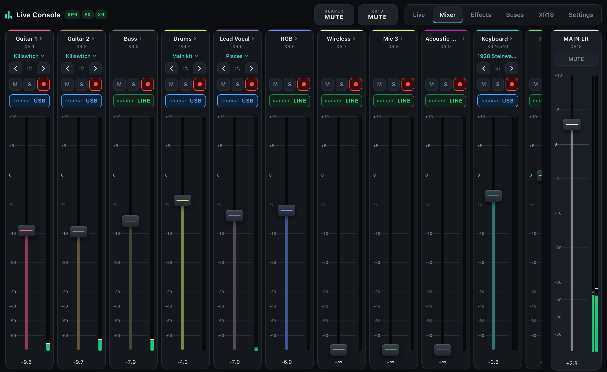
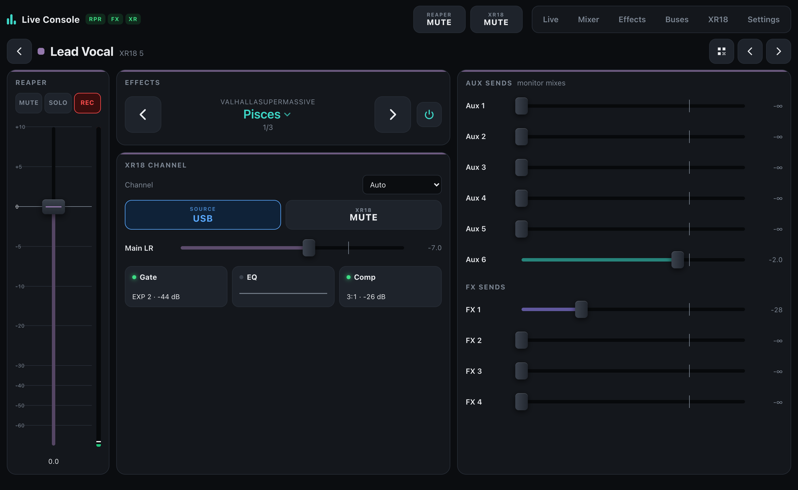
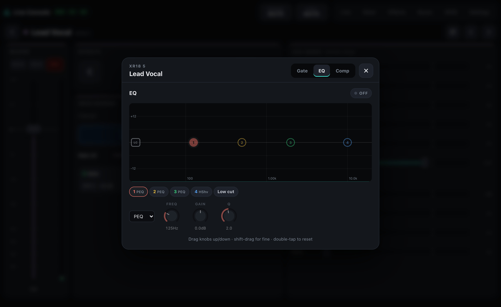
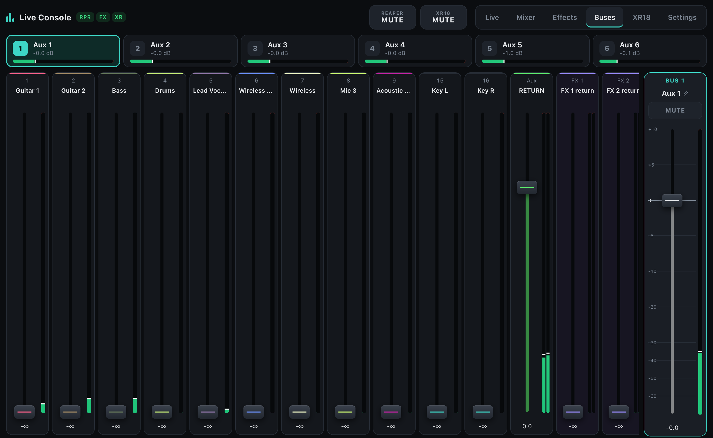

# Live Console

**A phone- and tablet-friendly web controller for live shows with REAPER and a Behringer X Air mixer (XR18 / X18 / XR16 / XR12 / MR18).**

REAPER hosts your amp sims, drum samplers and vocal effects; the X Air mixer is the audio interface and the stage mixer.
Live Console puts both on one screen: faders and meters for what you actually hear, effect presets you can switch by tapping a name,
whole-song sound recalls for every channel at once, monitor mixes, and a QR code that gives each musician their own controls on their phone.


## Features

- **Live tab**: build songs that recall FX presets (and on/bypass) on every track at once. Songs can have **sections** (Intro, Verse, Solo…) that change only what's different.
  Organise songs into **setlists**: switch between them, drag to reorder, and export/import them as files. A status line confirms the sounds are loaded or shows what was changed by hand.
- **Mixer**: one strip per REAPER track, with the XR18 channel fader and meter for that track (what the audience hears), REAPER mute/solo/arm, the current preset with ‹ › and a tap-to-pick list, and a **LINE / USB** source switch per channel. Main LR on the right.
- **Effects**: every effect on every track, with big preset buttons and bypass.
- **Track pages**: everything for one channel. That's presets, REAPER fader, XR18 channel (source, mute, level), sends to Aux 1–6 and FX 1–4, and **gate / EQ (with a draggable response curve) / compressor** editors.
- **Buses**: monitor mixes "sends on faders" style. Pick a bus to see every source's send into it, with meters and the bus master.
- **Artist pages + QR codes**: one tap on a track page shows a QR code. A musician scans it and gets *their* channel on their phone: a big mute, their effect presets, and how loud they are in each monitor. There's nothing that can upset front-of-house.
- **XR18 tab**: all 16 channels plus aux, with mute, source, fader and meter.
- Smooth 60 fps meters straight from the mixer. Changes made in X-Air Edit or on another device show up live. Works offline (no CDN), dark UI, sized for touch.

| Mixer | Track page | EQ |
|---|---|---|
|  |  |  |

| Buses | Artist view (phone) |
|---|---|
|  |  |

## Requirements

- **REAPER** 6 or 7 (tested on 7.86, macOS)
- A **Behringer X Air** mixer on the same network as the REAPER computer (tested on XR18, firmware 1.25; the X Air family shares one OSC protocol, so X18/XR16/XR12/MR18 should work, but they're untested. Channels a model doesn't have just show as empty)
- **Node.js 18+** on the REAPER computer ([nodejs.org](https://nodejs.org)). It runs the small bridge that talks to the mixer.
- Phones, tablets and laptops on the same network, with any modern browser

## Install

```sh
git clone <this repo> live-console
cd live-console
npm install
npm run setup
```

`npm run setup` finds your REAPER resource folder and does three things:

1. builds the page and copies it to `reaper_www_root/live-console.html`
2. adds a few lines to `Scripts/__startup.lua` (between clearly marked comments, with a `.bak` of the original) so the helper script runs whenever REAPER starts
3. tells you whether REAPER's web interface is already set up for it

Then, once, in REAPER:

1. **Preferences → Control/OSC/web → Add → Web browser interface**
   - *Default interface*: `live-console.html`
   - *Port*: e.g. `8080`
2. **Restart REAPER**, or run `reaper/live_console.lua` once via *Actions → Show action list → New action → Load ReaScript*.
3. Open `http://<your-computer's-ip>:8080/` on any device on the network. Setup prints the exact address.

The mixer is found automatically. To set its address by hand, go to *Settings → XR18 connection*.

Setup options: `--reaper "<resource folder>"` (portable installs, or if auto-detect fails; in REAPER: *Options → Show REAPER resource path*),
`--page <name>.html` (a different page name), `--deploy-only` (skip the startup script).

### Updating

```sh
git pull
npm install
npm run deploy     # rebuilds and re-copies the page
```

Reload the page on your devices. If `reaper/live_console.lua` changed, restart REAPER or run the script again; a new copy replaces the running one.

## Using it

- **Channel mapping**: each REAPER track is linked to the XR18 channel it comes from, automatically. It uses the track's record input (XR18 USB 1–16 = channel 1–16, 17/18 = aux), then a matching channel name, then a linked stereo pair with the same name stem ("Keyboard" → "Key L"/"Key R"). Override per track in *Settings* or on the track page.
- **Presets**: the full list comes from REAPER's user preset files (`presets/*.ini`), i.e. presets you saved from REAPER's FX preset menu. A plugin's own built-in presets still work with ‹ ›, but without a list.
- **Songs**: dial in the sounds, then tap **+ New song**. It starts from the current presets. Songs refer to tracks and presets **by name**, so renaming one breaks the link (the status line will say so).
- **Faders**: drag (relative, so they never jump), shift-drag for fine control, double-tap for 0 dB. **Knobs**: drag up/down.
- **Artist mode**: on a device in artist mode, hold the logo for 1 s to get back to the full app.

## How it works

```
 phone / tablet / laptop                       REAPER computer
┌────────────────────────┐  HTTP (REAPER's   ┌────────────────────────────────────┐
│ live-console.html      │  web interface)   │ REAPER                             │
│ (Vue, one file)        │──────────────────▶│  └ reaper/live_console.lua         │
│                        │                   │      publishes FX + presets,       │
│                        │                   │      runs preset/bypass commands   │
│                        │  HTTP + SSE :8899 │                                    │
│                        │──────────────────▶│ bridge/xr18-bridge.mjs (Node)  ────┼── OSC/UDP :10024 ──▶ X Air mixer
└────────────────────────┘                   │  mixer relay, meters, songs store  │
                                             └────────────────────────────────────┘
```

- **REAPER side**: the page polls REAPER's built-in web API for tracks and mute/solo state. The Lua script publishes each FX's preset state through REAPER ExtState and applies commands the page writes back. No REAPER extensions required.
- **Mixer side**: browsers can't send UDP, so a zero-dependency Node bridge relays OSC. It subscribes to mixer updates (`/xremote`) and meters (`/meters/1`), streams them to every browser over Server-Sent Events, and stores the Live tab's songs and setlists.
- **Your data** (songs, setlists, mixer address, bridge log) lives in `<REAPER resource folder>/LiveConsole/`, outside this repo, so updates never touch it. Back up `live-songs.json` with your show files.

## Troubleshooting

- **Status dots** in the header: **RPR** = REAPER web API, **FX** = the Lua script, **XR** = the mixer (yellow means the bridge is up but no mixer was found). *Settings* has details.
- **FX dot red**: the script isn't running. Restart REAPER, or load `reaper/live_console.lua` from the Action list.
- **XR dot red**: check `LiveConsole/bridge.log` in the REAPER resource folder. If Node isn't found (REAPER doesn't see your shell's PATH), set `NODE_PATH` at the top of `reaper/live_console.lua`. To run the bridge by hand: `npm run bridge`.
- **Mixer not found**: discovery uses a UDP broadcast. On some networks you need to enter the mixer's IP in *Settings → XR18 connection*.
- **Phones can't open the QR link**: they must be on the same network as the REAPER computer. Set the address in *Settings → QR codes* if the auto-detected one is wrong (e.g. a VPN interface).
- **OSC addresses**: *Settings → OSC learn* lists any change made in X-Air Edit, which is handy for exploring the protocol.

## Security

Built for a trusted local network (the band's own Wi-Fi). REAPER's web interface can be password-protected in its preferences, but the bridge on port 8899 has **no authentication**: anyone on the network can control the mixer through it. Don't expose either to the internet. Artist mode is for convenience, not a lock.

## Development

```sh
npm run dev       # hot reload at http://localhost:5173/live-console.html (proxies REAPER's API from :8080; REAPER_URL=... to change)
npm run build     # dist/live-console.html
npm run bridge    # run the bridge by hand (data in ./data)
```

```
src/                 Vue 3 app (views/, components/, lib/)
  lib/reaper.js      REAPER web API client + FX command channel
  lib/xr18.js        bridge client (SSE in, POST out)
  lib/meters.js      60 fps meter engine (outside Vue reactivity)
  lib/live.js        songs, sections, setlists
  lib/xrparams.js    X Air parameter scales (gate/EQ/comp), EQ response math
bridge/xr18-bridge.mjs   Node bridge (no dependencies)
reaper/live_console.lua  REAPER helper script
scripts/setup.mjs        installer
```

Notes on the protocols:

- REAPER's web server truncates request URLs at about 1 KB, so the page only sends short commands. Bulk data (FX state) is written by the Lua script.
- X Air OSC values are normalised floats; the scales in `lib/xrparams.js` were checked against the mixer's own `/node` text output.
- `/meters/1` delivers 40 levels about every 100 ms (fixed by the mixer): ch 1–16, aux L/R, FX returns 1–4 L/R, buses 1–6, FX sends 1–4, main L/R, monitor L/R.

## License

[MIT](LICENSE)

*Not affiliated with Cockos or Behringer/Music Tribe. REAPER, X Air and XR18 are trademarks of their respective owners.*
